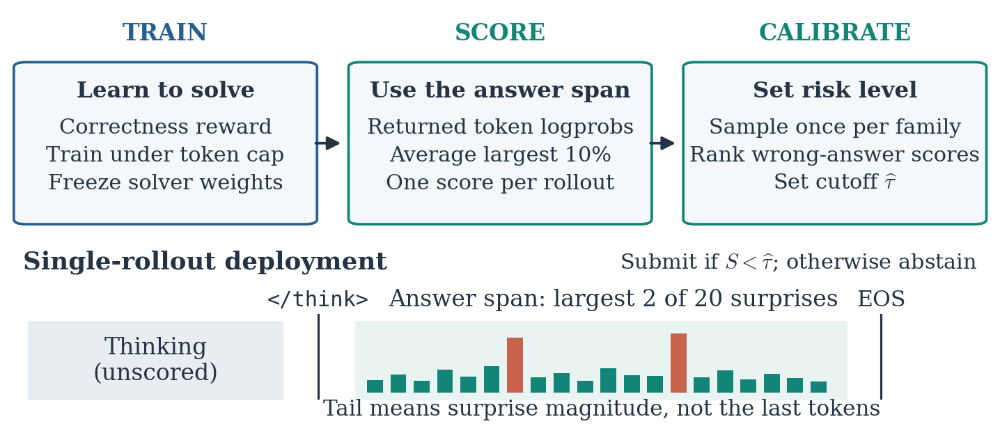
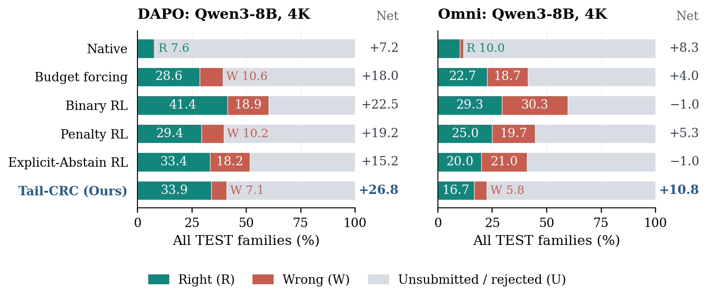

<a name="tail-crc"></a>


# Decoupling Solving from Abstention: Single-Rollout Conformal Risk Control for Hard-Budget LLM Reasoning

Qianyi Chen and Bo Li

[](https://cqyiiii.github.io/tail-crc/)
[](https://cqyiiii.github.io/tail-crc/paper.pdf)
[](https://arxiv.org/abs/2611.31065)
[](https://huggingface.co/datasets/Cqyiii/tail-crc-observations)
[](LICENSE)

Tail-CRC lets a math solver spend its token budget on one answer, then uses that answer’s token probabilities to decide whether to submit it. You choose a target rate for wrong submissions and fit the cutoff on held-out problem families.

**[See the results](#results)** · **[Reproduce the paper](#reproduce-the-paper)** · **[Try Tail-CRC](#quickstart)** · [Solver weights](#solver-weights) · [Cite](#citation)

## How Tail-CRC works

1. **Solve.** Train a solver with binary rewards under a fixed token cap. Freeze it before calibration.
2. **Score.** For an answer of length *L*, average the largest ⌈*L*/10⌉ negative log probabilities among its sampled answer tokens. A few surprising tokens can raise the score even when they occur early in the answer.
3. **Calibrate and submit.** Use one labeled rollout per calibration family to fit a cutoff. On a new family, submit a valid answer only when its score is strictly below the cutoff. Ties abstain.



[Method diagram (PDF)](assets/fig_method_overview.pdf) · [SVG](assets/fig_method_overview.svg) · [Reference implementation](tail_crc/__init__.py)

## Results

On **8B Omni-MATH at 8K**, Tail-CRC reduced wrong submissions from **41.8% to 6.5%**. Correct submissions also fell, from **38.8% to 18.0%**. Both rates use *all* test families as the denominator, including those where the solver abstained.


[Omni-MATH comparison (PDF)](assets/omni-calibration.pdf) · [SVG](assets/omni-calibration.svg)

<details>
<summary><strong>All eight operating points · DAPO and Omni-MATH</strong></summary>

Each cell gives **correct / wrong** submissions (%). Cutoffs are fitted separately by solver seed on same-domain calibration families at α = 6.5%. Results average the two seeds within each test family.

**DAPO**

| Model · cap | Binary RL | Tail-CRC |
|:---|---:|---:|
| 4B · 4K | 47.9 / 5.0 | 47.9 / 5.0 |
| 4B · 8K | 57.6 / 6.3 | 57.6 / 6.3 |
| 8B · 4K | 41.4 / 18.9 | 33.9 / 7.1 |
| 8B · 8K | 57.5 / 26.4 | 39.1 / 5.9 |

**Omni-MATH**

| Model · cap | Binary RL | Tail-CRC |
|:---|---:|---:|
| 4B · 4K | 25.3 / 9.8 | 17.8 / 3.7 |
| 4B · 8K | 30.5 / 12.8 | 24.3 / 5.8 |
| 8B · 4K | 29.3 / 30.3 | 16.7 / 5.8 |
| 8B · 8K | 38.8 / 41.8 | 18.0 / 6.5 |

</details>

<details>
<summary><strong>Compare the 8B baselines at 4K · correct, wrong and unsubmitted</strong></summary>



[Hard-budget outcomes (PDF)](assets/fig1_three_state.pdf) · [SVG](assets/fig1_three_state.svg)

</details>

On **4B DAPO**, both fitted cutoffs accepted every valid answer. On **8B DAPO at 4K**, the observed wrong-submission rate was **7.1%**. Theorem 1 controls the *expected marginal* wrong-submission rate under exchangeability. An individual test panel can exceed the target.

Withholding a completed answer still incurs its generation cost. The paper’s token savings measure the effect of **Binary RL versus the base model** under the same budget forcing.

## Reproduce the paper

Use **Python 3.11 on CPU**. The first run downloads eight checksum-pinned numerical inputs from Hugging Face. From a clean environment, run

```sh
git clone --branch v1.1.1 https://github.com/Cqyiiii/tail-crc.git
cd tail-crc
python3.11 -m venv .venv
. .venv/bin/activate
python -m pip install -r requirements-paper.txt
make paper
```

Open `output/paper/tables/` for the **12 manuscript tables** and their field-level checks. Open `output/paper/figures/` for the **eight figures** in PDF, SVG and PNG. The same command runs the three numerical theory checks. [Table guide](paper/TABLES.md) · [Figure inputs](paper/inputs/README.md)

<details>
<summary><strong>Partial runs, offline replay and evidence limits</strong></summary>

- `make reproduce` rebuilds the six underlying evidence tables and five diagnostic plots, then checks 43,185 fields. `make theory` runs the reference-rule tests and the numerical checks for CRC, the score and the RL objective.
- For an offline run after installing dependencies, place the eight files listed in the [data manifest](data-files.json) in `data/`. The loader verifies their sizes and SHA-256 checksums.
- On macOS 14 or later, if an older Conda Python reports macOS 10.16 and pip cannot find a SciPy wheel, run `SYSTEM_VERSION_COMPAT=0 python -m pip install -r requirements-paper.txt`.
- Nine manuscript tables use public measurements. One compares published method definitions, and two use recorded exploratory aggregates. The case illustration uses sampled token counts. Training-curve active-group fractions, four DEV parity means and eight CPU timing quantiles are available as recorded summaries.
- The release supports paired family-level analysis from recorded grades, scores and costs. Regrading raw answers, generating new rollouts and repeating GPU timings require additional inputs. The 484-family reserve remains sealed.

</details>

## Quickstart

To try the decision rule on its own, run `python -m examples.quickstart_tail_crc` from the repository root. The example uses the Python standard library. Each calibration row is one family. **R** means correct, **W** means wrong and **U** means no valid submission.

```python
from math import inf
from tail_crc import crc_threshold, tail10_nll

# One CAL family per row, all from the same frozen solver and seed.
cal = [("W", 0.3), ("R", 0.1), ("W", 0.7), ("U", inf)]
cut = crc_threshold(cal, "0.4")  # j = floor(5 * 0.4) = 2

# Sampled answer-span log probabilities after the first close and before EOS.
# Remove prefill and injected delimiters/newlines before calling tail10_nll.
for logp, valid in [([-0.1, -0.2], True), ([-0.7], True), ([], False)]:
    score = tail10_nll(logp, valid=valid)
    submit = valid and score < cut
    print(f"score={score:g} cutoff={cut:g} submit={submit}")

assert cut == 0.7 and not (0.7 < cut)  # reject cutoff ties
assert crc_threshold(cal, "0.1") == -inf  # j = 0
assert crc_threshold(cal, "0.8") == inf   # fewer than j wrong answers
```

The example fits a cutoff of **0.7**. It submits the answer scoring **0.2**, withholds the answer tied at **0.7**, and withholds the invalid answer. Theorem 1 assumes exchangeable families and a fixed solver, decoder, verifier and score.

## Solver weights

Four public Binary RL LoRA adapters cover **Qwen3.5-4B** and **Qwen3-8B**, each at seeds **41** and **73**. Each release includes the original factors, PEFT adapter, base revision and checksums. Fit a submission cutoff separately for your calibration setting. [Model links, PEFT and vLLM examples, and 4B weight reconstruction](ADAPTERS.md)

## Repository guide

| To inspect | Open |
|:---|:---|
| Score and calibration rule | [Implementation](tail_crc/) · [Runnable example](examples/) |
| Family-level estimates and checks | [Replay](replay/) · [Frozen references](validation/) |
| Manuscript tables, figures and theory | [Paper build](paper/) · [Numerical checks](theory/) |
| Observations and pinned revisions | [Data dictionary](DATA_CARD.md) · [Release manifest](release.json) |
| Chart generation and adapter conversion | [Tools](tools/) |

## Paper names and archived identifiers

<details>
<summary><strong>Look up an identifier from Appendix B.1 or the released logs</strong></summary>

| Paper name | Archived record |
|---|---|
| Native | `Native/base` |
| Budget forcing | `ExtBF/base` (decoder `BF` in observations) |
| Answer-SFT | 4B `E1_41`, 8B `M5_41` |
| Binary RL | `G0_41`, `G0_73` (pooled results average seeds within each family) |
| Binary RL with native decoding | `Native/G0_41` |
| Penalty RL | `G1_41` (wrong-answer reward −1) |
| Mild-Penalty RL | `S3B` (wrong-answer reward −0.25) |
| Explicit-Abstain RL | `S3A` (abstention action and wrong-answer reward −1) |
| Tail-CRC | Binary RL, `tail10_nll`, one CRC fit per seed |
| Tail / Box / Mean / Sum NLL | `tail10_nll`, `box_sum_nll`, `ans_mean_nll`, `ans_sum_nll` |
| Tail entropy | `tail_H` |
| Source / target calibration | Track A (DAPO cuts) / Track B (natural Omni CAL300 cuts) |
| DAPO source / independent Omni study | `pc_crc_confirm_2a_v1` / `pc_crc_ood_confirm_v1` |

</details>

## Citation

```bibtex
@misc{chenli2026tailcrc,
  title  = {Decoupling Solving from Abstention: Single-Rollout Conformal Risk Control for Hard-Budget {LLM} Reasoning},
  author = {Qianyi Chen and Bo Li},
  year   = {2026},
  eprint = {2611.31065},
  archivePrefix = {arXiv},
  primaryClass = {cs.AI},
  doi    = {10.48550/arXiv.2611.31065},
  url    = {https://arxiv.org/abs/2611.31065}
}
```

[Software citation](CITATION.cff) · [Code license (Apache 2.0)](LICENSE) · [Observations and validation references (CC BY 4.0)](https://huggingface.co/datasets/Cqyiii/tail-crc-observations)
