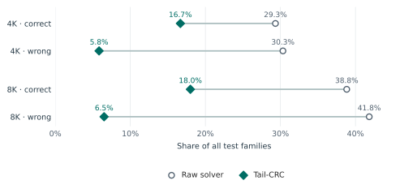

# Tail-CRC

**Which answers should a reasoning model submit when its token budget runs out?**

In **Solve-then-Calibrate**, a model learns to finish a mathematical answer within a fixed budget. **Tail-CRC** then uses uncertainty in that same answer to decide whether to submit it.

[Reproduce the results](#reproduce-the-results) · [Explore the results](#results) · [Evaluation data](https://huggingface.co/datasets/Cqyiii/pc-crc-observations) · [Solver weights](#solver-weights)

*Decoupling Solving from Abstention: Single-Rollout Conformal Risk Control for Hard-Budget Reasoning* · Qianyi Chen

## How Tail-CRC works

1. **Solve.** Train a budget-forced solver with ExtBF-GRPO and binary rewards for a correct answer. Freeze the solver.
2. **Calibrate.** On held-out problem families, score each completed answer by averaging the largest tenth of its token surprisals (rounding the token count up). Fit a submission threshold for the target rate of wrong submissions.
3. **Submit or abstain.** On a new problem, submit a valid answer if its score is below the threshold. The decision uses the existing rollout. A withheld answer still incurs its generation cost.

## Results

On 300 held-out Omni-MATH families, Tail-CRC reduced both wrong and correct submissions. The comparison below uses Qwen3-8B, averages training seeds 41 and 73 within each family, and sets a 6.5% marginal wrong-submission target using a separate Omni-MATH calibration split.



[PDF](assets/omni-calibration.pdf) · [SVG](assets/omni-calibration.svg)

The replay also lets you investigate:

- **Budget and cost.** Compare native decoding with external budget forcing at 4K and 8K. Estimate paired differences in correct submissions, wrong submissions, output length and dollars per problem. [Operating points and paired estimates](replay/main_panels.py)
- **Training rewards.** Compare the binary-reward solver with wrong-answer penalties and explicit abstention. Inspect their risk–coverage curves and training traces. [Training and calibration summaries](replay/figure_data.py)
- **Score choice and transfer.** Compare tail surprisal, final-answer likelihood and white-box entropy. Apply DAPO thresholds to Omni-MATH or refit on target-domain calibration families. [Score comparisons](replay/uncertainty.py) · [Transfer estimates](replay/main_panels.py)
- **Serving cost.** Rebuild throughput, warm-engine timing, adapter parity and the exploratory two-draw comparison from recorded measurements. [Systems replay](replay/systems.py)

## Reproduce the results

Use Python 3.11. The numerical replay runs on CPU.

```sh
git clone https://github.com/Cqyiiii/pc-crc.git
cd pc-crc
python3.11 -m venv .venv
. .venv/bin/activate
python -m pip install -r requirements.txt
make reproduce
```

The first run downloads eight checksum-pinned files. Later runs can use the verified local copies offline. Open `output/` for six evidence tables, PNG and SVG plots, and `validation.json`. The verifier checks 43,185 fields against the archived references.

<details>
<summary>Offline installation, alternative commands and checks</summary>

Install pinned packages from a local wheelhouse with `python -m pip install --no-index --find-links WHEELHOUSE -r requirements.txt`. For an offline replay, prepopulate `data/` with the eight files in the [data manifest](data-files.json).

Without Make, run `python fetch_data.py`, `python reproduce.py` and `python verify.py` in order. Use `make reproduce OUT=other-output` for a separate results directory. To regenerate the README chart as SVG and PDF, install the plotting dependencies with `python -m pip install seaborn==0.13.2 pandas==2.3.3`, then run `python tools/plot_readme.py` after the replay.

</details>

<details>
<summary>Statistical definitions and scope</summary>

R, W and U denote correct submissions, wrong submissions and all remaining outcomes. Marginal wrong-submission risk divides W by all problem families. Conditional wrong risk divides W by R + W when at least one valid answer is submitted.

The released records cover 42,000 deployments from 1,800 problem families. For pooled G0 results, each family contributes the mean across the two training seeds. Paired contrasts use 20,000 shared bootstrap draws. White-box discrimination uses 2,000 draws in the original family order. The replay retains the original 8B DAPO target overruns and unissued conditional certificates.

The inputs start at recorded grades and scores. Fresh generation, independent grading of answer text, and end-to-end timing require additional inputs or compute. Four DEV parity means and eight CPU timing quantiles survive as historical summaries. The separate 484-family Omni-MATH reserve remains sealed. [Data dictionary and study provenance](DATA_CARD.md)

</details>

## Solver weights

Each Hugging Face repository contains one G0 solver in directly loadable PEFT form and its original LoRA export. Tail-CRC fits the submission threshold separately from these weights.

| Base model | Seed 41 | Seed 73 |
|---|---|---|
| Qwen3.5-4B | [Adapter](https://huggingface.co/Cqyiii/PC-CRC-G0-4B-seed41) | [Adapter](https://huggingface.co/Cqyiii/PC-CRC-G0-4B-seed73) |
| Qwen3-8B | [Adapter](https://huggingface.co/Cqyiii/PC-CRC-G0-8B-seed41) | [Adapter](https://huggingface.co/Cqyiii/PC-CRC-G0-8B-seed73) |

The 4B export contains 498 factor tensors. Fusing its hybrid QKV projections yields 402 PEFT tensors. Both layouts contain 506 tensors for 8B. [Conversion code](tools/convert_adapter.py) · [Pinned data and model revisions](release.json)

## Citation and license

Use the [citation file](CITATION.cff) for software attribution and cite the data revision used. The code is licensed under [Apache-2.0](LICENSE). The derived numerical records are released under [CC BY 4.0](https://creativecommons.org/licenses/by/4.0/).
